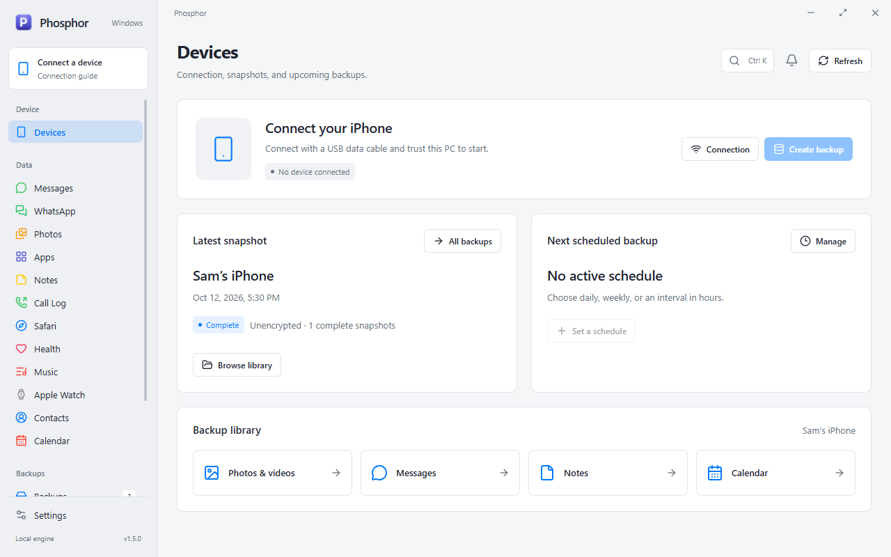
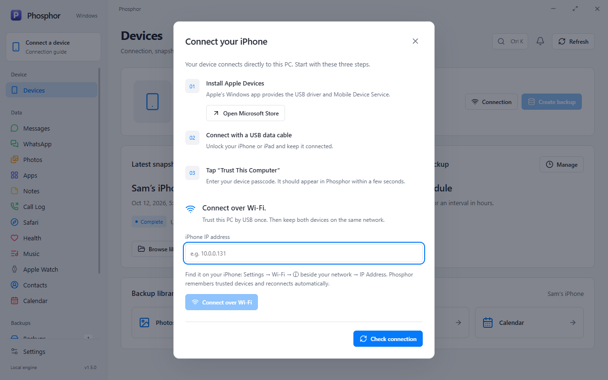
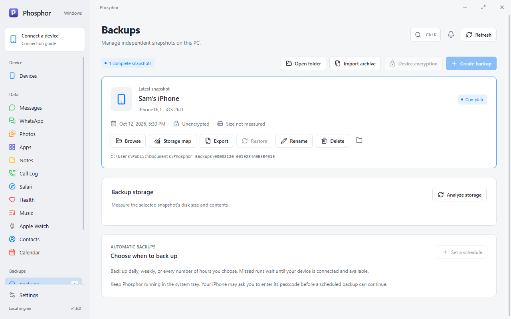
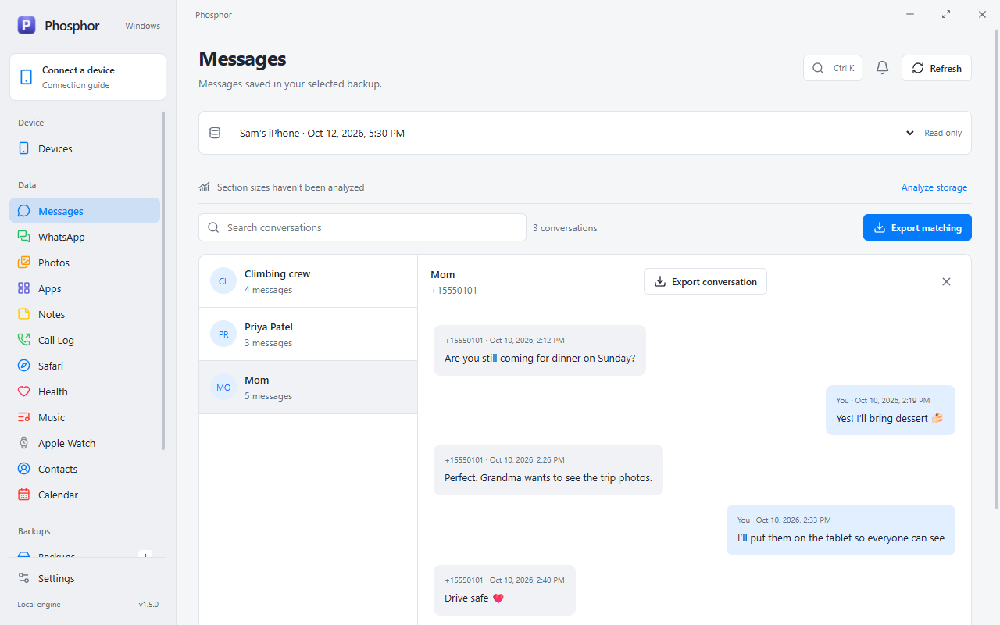
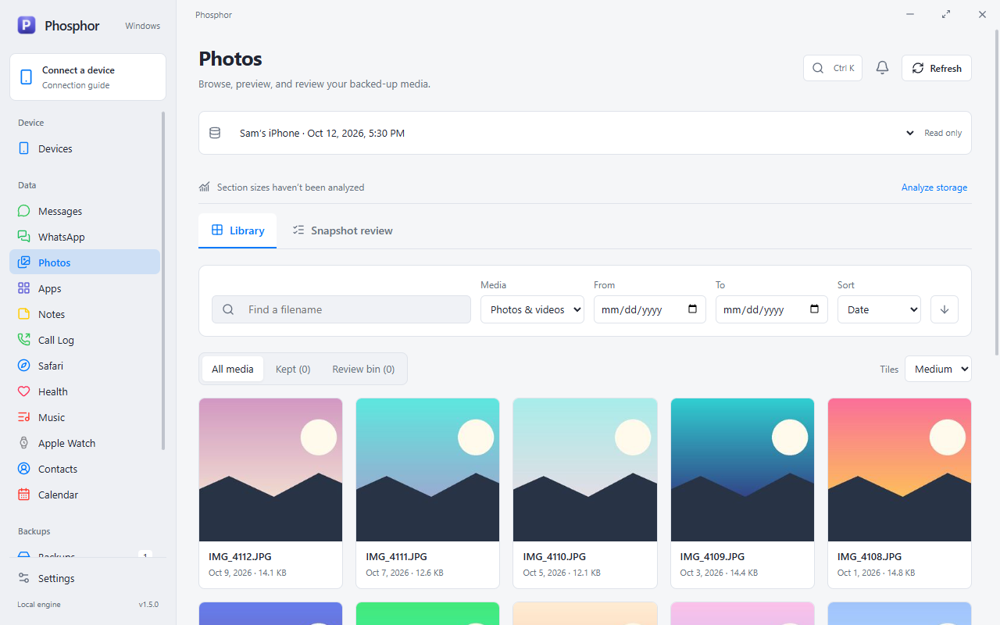
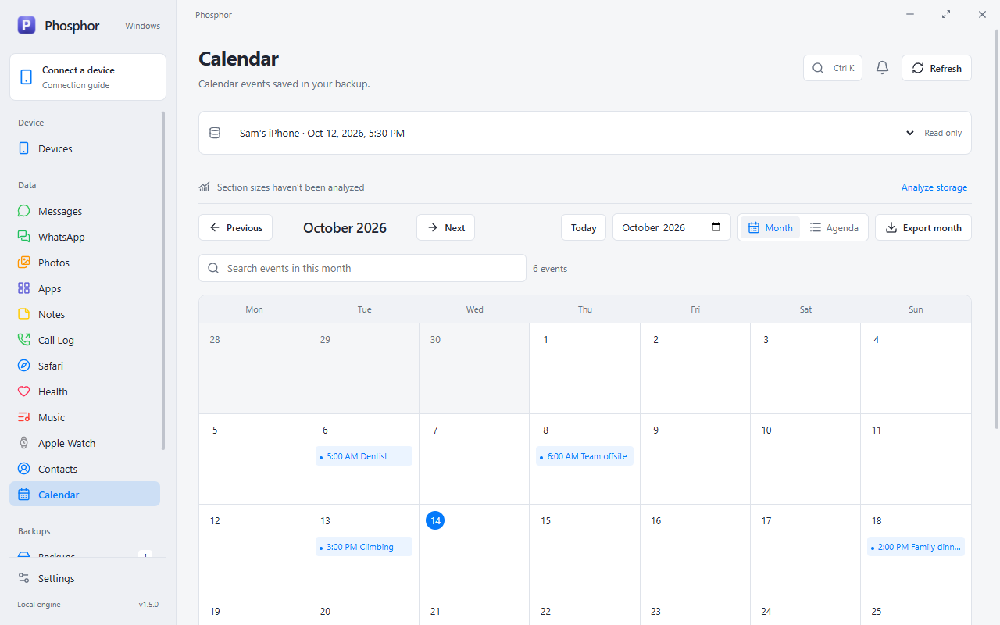
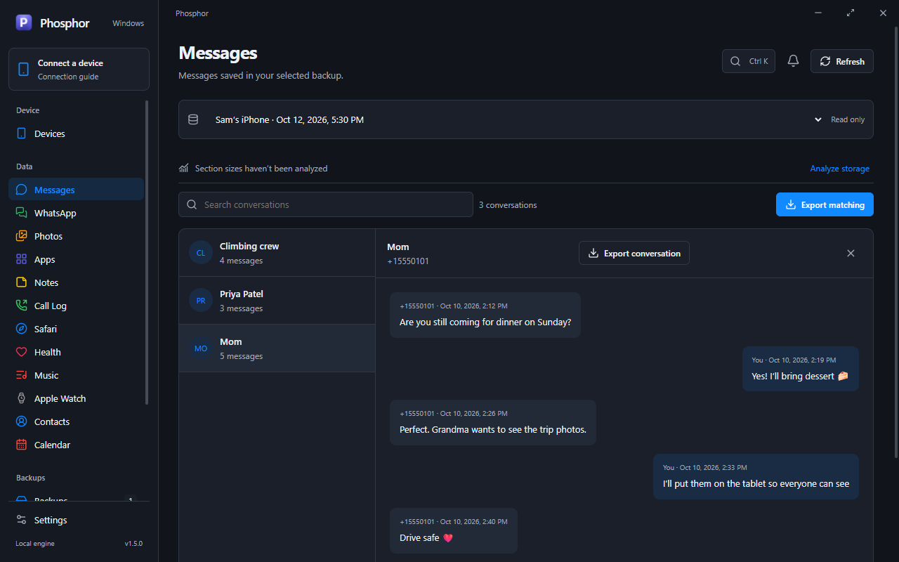

# Phosphor for Windows

Phosphor for Windows brings the macOS app to Windows 10 and 11 (x64): back up your iPhone or iPad, browse what's inside a backup, and export your data, without iTunes, iCloud, or a subscription. It keeps the macOS app's sidebar (Device, Data, Backups, Tools), labels, colors, and icon, with an Electron interface over a bundled device engine built on [pymobiledevice3](https://github.com/doronz88/pymobiledevice3).



> Screenshots use a synthetic demo backup; no real personal data is shown.

## Requirements

- Windows 10 or 11, 64-bit Intel/AMD. ARM64 and 32-bit builds are not produced.
- [Apple Devices from Microsoft Store](https://apps.microsoft.com/detail/9np83lwlpz9k) for Apple's USB driver and Mobile Device Service. Drivers installed by iTunes also work.

Python and Node.js are bundled with the app and are only needed to [build from source](#build-from-source). You can browse existing backups without a device connected.

## How to use

### 1. Install

Run `Phosphor-<version>-x64-Setup.exe` for a Start menu install, or `Phosphor-<version>-x64-Portable.exe` to run without installing. Windows builds are produced by [`scripts/build.ps1`](#build-from-source). Local builds are unsigned, so Windows SmartScreen may ask you to confirm the first launch.

### 2. Connect your iPhone

1. Install **Apple Devices** from Microsoft Store.
2. Connect your iPhone with a USB data cable and unlock it.
3. Tap **Trust This Computer** and enter your passcode.
4. Click **Refresh**. Your device appears in the top-left corner of the sidebar.

Click the device card at any time to open the connection guide.



**Wi-Fi:** after trusting the PC once over USB, turn on Wi-Fi sync on the iPhone and keep both devices on the same network. Phosphor finds trusted devices automatically, or you can enter the iPhone's IP address (**Settings → Wi-Fi → ⓘ → IP Address** on the iPhone) under **Connect over Wi-Fi**. USB takes priority whenever both are available.

### 3. Back up

Open **Backups** and click **Create backup**. Choose:

- **Full backup**: a complete, independent snapshot.
- **Incremental snapshot**: copies your last snapshot, then updates it. Faster, but needs room for a second copy.

Progress appears under the bell icon (**Activity**), where you can also cancel. iOS may ask for the device passcode on the iPhone before the backup starts. Use **Device encryption** to turn encrypted backups on or off, or to change their password.



Each snapshot card lets you **Browse** its files, view a **Storage map**, **Export** a portable `.phosphor` archive, **Restore** it to a connected device, **Rename** it, or **Delete** it to the Recycle Bin. **Open folder** adds existing Apple Devices or iTunes backups, and **Import archive** brings in a `.phosphor` file.

### 4. Browse and export your data

Pick a section under **Data** in the sidebar. The bar at the top selects which backup you are reading. Encrypted backups ask for their password once, and it stays in memory only until you lock the backup or quit.



- **Messages / WhatsApp**: pick a conversation to read it. Use **Export conversation** or **Export matching** to save HTML, CSV, JSON, or TXT.
- **Photos**: filter by date or type and sort by date, filename, or size. Double-click to preview and select items to extract the originals. **Snapshot review** lets you sort photos into keep or review and scan for exact duplicates or similar photos.
- **Notes, Call Log, Safari**: search and filter by date (and by call duration), then export.
- **Contacts, Calendar**: export contacts as vCard, CSV, or JSON, and calendars as ICS, CSV, or JSON, with month and agenda views.
- **Health, Music, Apple Watch**: extract the original backed-up files.
- **Backup Browser**: walk the backup's domains and folders and extract any original file.





Exports never overwrite existing files; Phosphor picks a new name instead.

### 5. Device tools

With a device connected:

- **Apps**: lists installed apps, installs a signed `.ipa`, and removes apps.
- **File System**: transfers files to and from the device's Media area. Deleted files go to a recoverable Phosphor Trash.
- **Diagnostics**: shows battery and storage readings, device identity, restart and sleep, a live console, and screenshots when iOS developer services are available.

### 6. Automatic backups

On **Backups** (or in **Settings**), click **Set a schedule** to back up every day, every week, or every few hours. Schedules run while Phosphor is open or minimized to the system tray. Missed runs wait until the device is reachable over USB or Wi-Fi. Turn on **Start with Windows** in Settings so schedules keep running after you sign in. Use **Quit Phosphor** from the tray icon to exit completely.

### Settings and appearance

**Settings** changes where new backups are saved (`%LOCALAPPDATA%\Phosphor\Backups` by default), manages saved Wi-Fi devices, and switches between light, dark, and system appearance. Press **Ctrl+K** anywhere to jump to a page, and **Ctrl+F** to search the current one.



## Good to know

- Readiness, Time Machine restore, Home Screen layout, Unified Search, and Location simulation are macOS-only for now. The interface is English only.
- Notes show plain text; formatting, attachments, and separately locked notes aren't rendered. Health and Watch data is available as original files rather than a full viewer.
- A running backup holds the device exclusively; other live views wait until it finishes.
- Settings live in `%APPDATA%\Phosphor`. Interrupted backups stay in a `.inprogress` folder and never appear as complete.
- Backup passwords and decrypted keys are never written to disk or passed to other processes. At most two encrypted backups stay unlocked at once.

## Build from source

Install Python 3.12 x64 and Node.js 22 or newer, then run from this folder in PowerShell:

```powershell
./scripts/build.ps1
```

This creates `.venv`, installs the locked dependencies, runs the tests and a strict TypeScript check, builds the engine with PyInstaller, smoke-tests it, and writes the installer and portable executable to `release/`. Add `-SkipInstall` once dependencies are installed, or `-PortableOnly` for just the portable build.

For development, run `npm run dev`, then `npm start -- --dev` in a second terminal. `npm test` runs the regression suite against synthetic backups, never your own data or devices. `python scripts/smoke-engine.py` exercises the engine end to end (`--frozen` checks the PyInstaller build). Format with `black backend tests scripts` and `npm run format`; CI checks both.

## Architecture

```
windows/
  electron/   Main process: engine lifecycle, IPC allow-list, tray, private media protocol
  src/        React renderer: app shell, sidebar, dialogs, and shared components
  src/views/  One view per sidebar section, reading shared state from the AppModel context
  backend/    Python engine: JSON-lines RPC over stdio (worker.py) and services
  tests/      pytest and node:test regression suites with synthetic fixtures
  scripts/    Build, packaging, icon, license, and smoke-test scripts
```

The layering follows the macOS app. Services wrap device and backup access, and views read shared state from a context that plays the role of the macOS environment objects. Views never run commands directly; every device or file operation goes through the engine. The engine never opens a network port, the renderer can only call allow-listed methods, and file paths must come from Phosphor's own pickers. `scripts/create-icon.py` derives the Windows icons from `Resources/AppIcon.icns`, so both editions share one icon.

## Licenses

Phosphor is MIT. The bundled engine includes GPL-3.0 `pymobiledevice3` and `pyiosbackup` and LGPL-3.0 `pytypedstream`; redistributing the engine follows those terms. Builds include dependency license texts and the corresponding Python source under `resources/licenses` and `resources/source`. See [THIRD_PARTY_NOTICES.md](THIRD_PARTY_NOTICES.md).
